# RoomMate

Aplicación Android en Java para organizar la convivencia en un piso compartido: tareas del piso, registro de quién las hace, compañeros de piso y una lista de la compra personal para cada usuario.

Proyecto de la 1.ª evaluación de **Programación Multimedia y Dispositivos Móviles (PMDM)**, 2.º DAM, IES Claudio Moyano, curso 2026-27.

- **Autor:** Mario Rapado Sánchez
- **Repositorio:** https://github.com/MarioRapSan/PMDM-DAM2

## Requisitos

- Android Studio (versión reciente, con soporte para `compileSdk 37`).
- JDK 11 o superior (el que trae Android Studio).
- Emulador o móvil con **Android 10 (API 29)** o superior.

## Instalación y ejecución

1. Clona el repositorio:
   ```bash
   git clone https://github.com/MarioRapSan/PMDM-DAM2.git
   ```
2. Ábrelo en Android Studio con **File → Open** y espera a que termine la sincronización de Gradle.
3. Elige un emulador o un móvil y pulsa **Run ▶**.
4. Para ver la carga inicial de datos, haz una **instalación limpia**: desinstala antes la app del dispositivo (o borra sus datos en *Ajustes → Aplicaciones → RoomMate → Almacenamiento → Borrar datos*).

## Credenciales de prueba

| Usuario | Clave |
|---|---|
| `admin` | `admin` |
| `mario` | `mario` |
| `jose` | `jose` |
| `raul` | `raul` |
| `winwaleo` | `winwaleo` |

`jose`, `raul` y `winwaleo` tienen ya su perfil de compañero; `admin` y `mario` pueden crearlo desde **Compañeros → Crear mi perfil**.

También puedes crear un usuario nuevo con el botón **Registrarse** de la pantalla de inicio.

## Datos de ejemplo (carga inicial)

La primera vez que se abre la app, si la base de datos está vacía, se cargan:

- **5 usuarios** en SQLite: `admin`, `mario`, `jose`, `raul` y `winwaleo` (estos tres ligados a su perfil de compañero).
- **6 tareas** en Room, 4 pendientes y 2 hechas, 2 de ellas marcadas como compartidas.
- **1 registro** de la tarea "Limpiar baño", que es la relación 1-N de ejemplo.
- 3 compañeros de piso, 12 productos de la compra y 2 productos en la lista personal de `admin`.

Son un punto de partida: se pueden añadir, editar y borrar.

## Funcionalidad

- **Login** contra la tabla `usuarios`, con **registro**, **cambio de clave** y **baja** de usuario.
- **Pantalla principal**: listado de tareas con RecyclerView y CardView, filtro hechas/pendientes, ordenación, barra de progreso y **menú lateral** con todas las secciones.
- **Ficha de la tarea** con sus registros. Desde la ficha se puede editar y abrir sus registros.
- **Alta, edición y borrado** de tareas. Clic largo sobre la tarjeta → menú contextual Editar/Eliminar.
- **Registros de tareas**: alta, edición y borrado, con dos Spinner dependientes (compañero → tareas).
- **Lista de la compra personal**, distinta para cada usuario, y gestión del **catálogo de productos**: añadir productos nuevos (diálogo con formulario) y borrarlos.
- **Búsqueda** de tareas por nombre y prioridad.
- **Compañeros de piso**: listado con tarjetas y ficha de cada uno. Cada usuario tiene **un único perfil ligado a su cuenta** y solo puede crear, editar o borrar **el suyo**; los demás son de solo lectura. Desde la ficha se puede enviar un correo al compañero.
- **Menú lateral** (Navigation Drawer) en la pantalla principal, menú de opciones y menús contextuales en las tarjetas de tareas y de compañeros.
- **DialogFragment** propios: confirmación, selector de fecha (DatePicker) y selector de hora (TimePicker).
- **Idiomas**: español, inglés (`values-en`) y japonés (`values-ja`). Se cambia con el idioma del móvil o, en Android 13+, solo para la app (Ajustes → Apps → RoomMate → Idioma), gracias a `locales_config.xml`.
- **Modo oscuro**: Switch en Ajustes y entrada "Cambiar tema" en el menú lateral. La paleta oscura está en `values-night/colors.xml` y el modo elegido se guarda en SharedPreferences (`Tema.java`, aplicado al arrancar en `RoomMateApp`).
- Se conserva lo escrito al **girar la pantalla**, con un layout horizontal propio para los registros.

## Capturas

Hechas en un emulador Pixel 9 (API 37), en distintos idiomas y temas para mostrar la traducción y el modo oscuro. Están todas en [docs/capturas](docs/capturas).

| Login | Colección de tareas | Ficha | Edición |
|---|---|---|---|
| 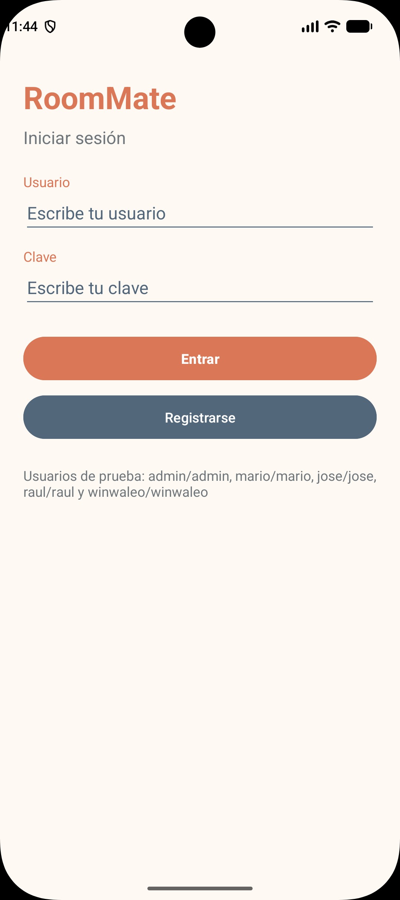 | 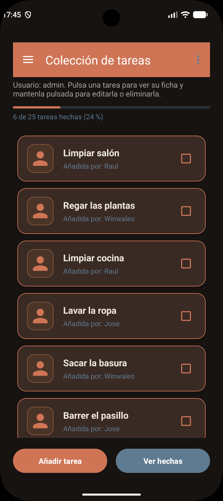 | 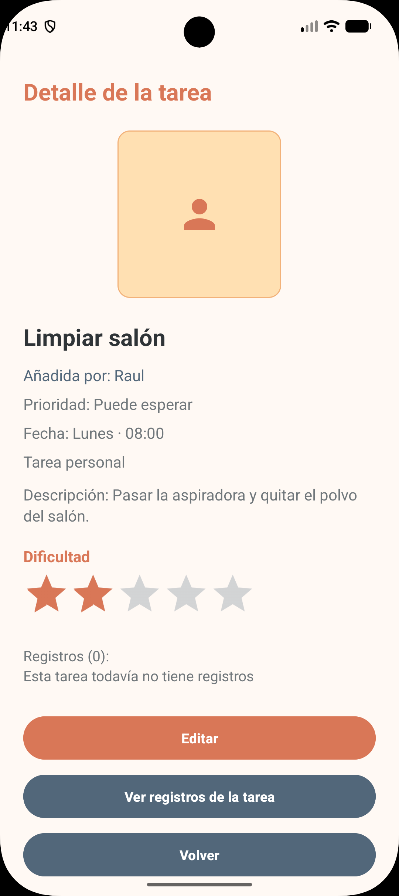 | 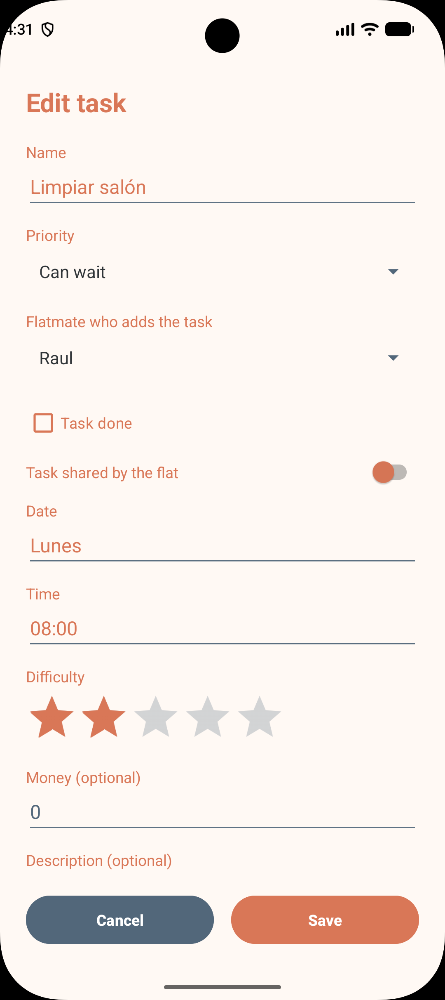 |
| **Selector de fecha** | **Menú lateral** | **Lista de la compra** | **Registros de una tarea** |
| 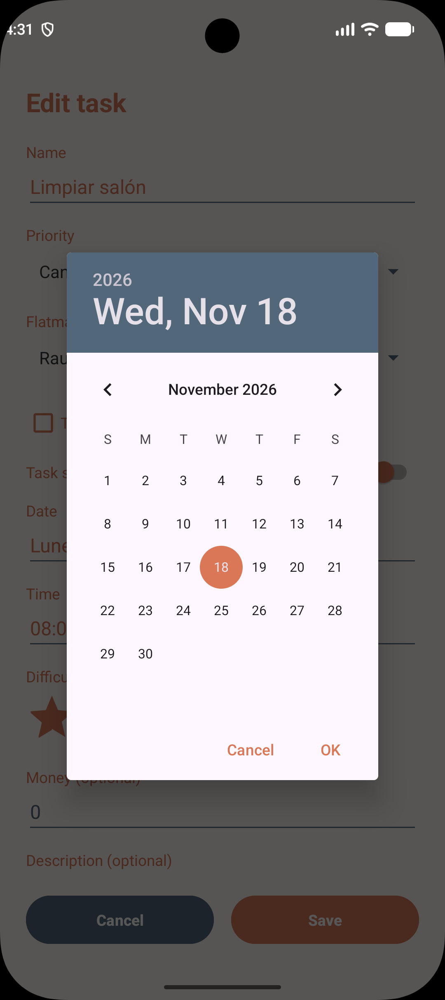 | 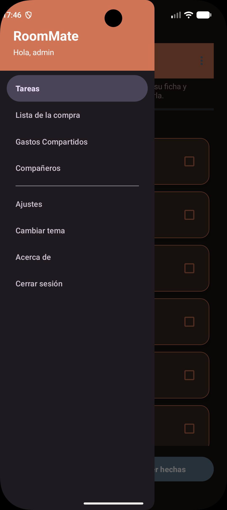 | 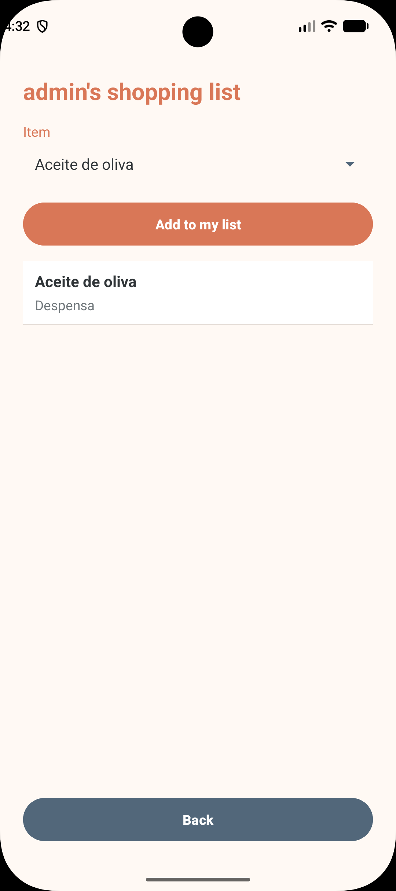 | 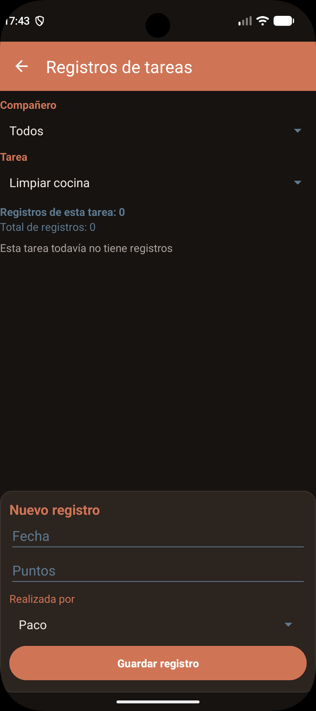 |
| **Login (modo oscuro)** | **Colección (modo oscuro)** | **Colección (japonés)** | **Ajustes de la cuenta** |
| 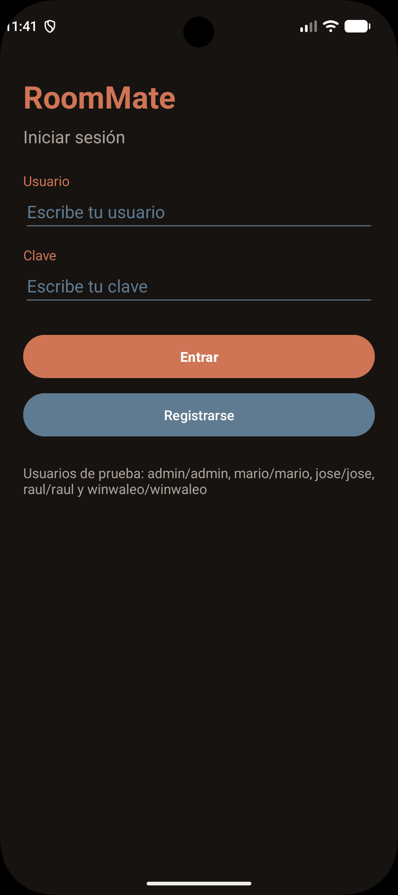 | 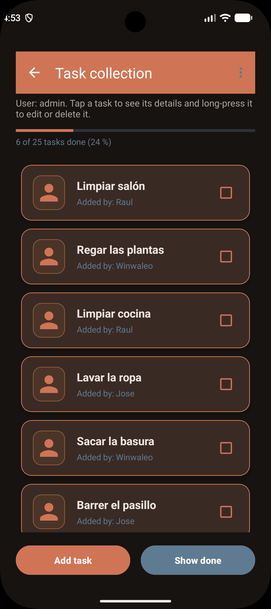 | 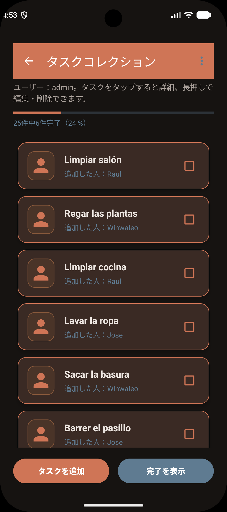 | 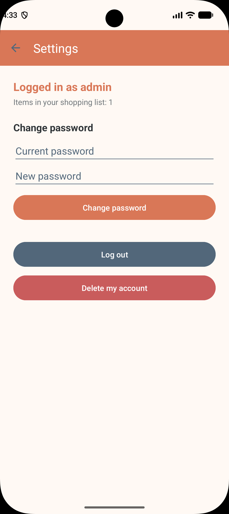 |
| **Compañeros (tu perfil marcado)** | **Tu propia ficha** | **Crear mi perfil** | |
| 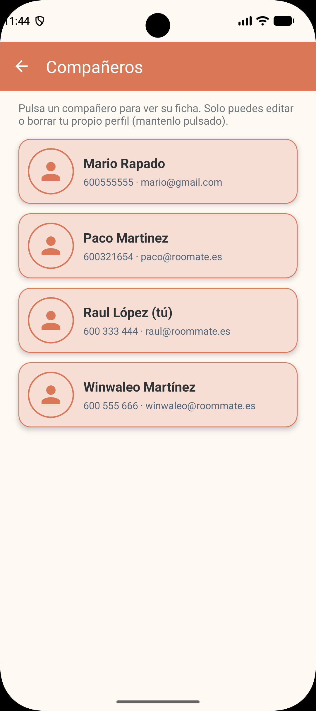 | 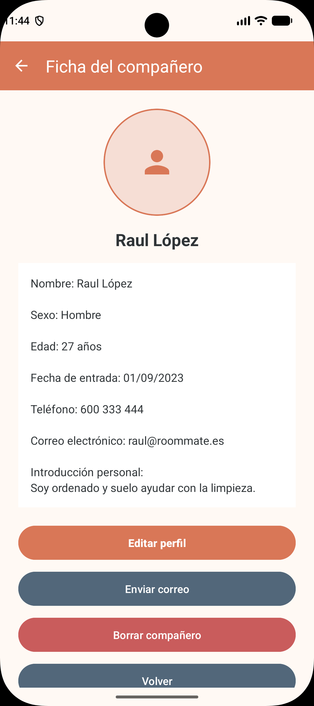 | 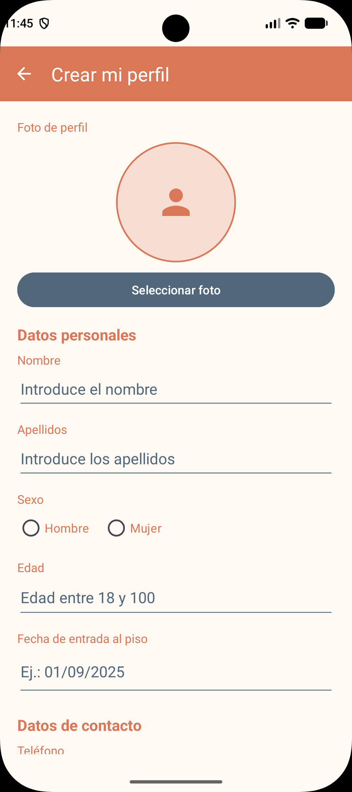 | |

## Bases de datos

| Base | Tablas | Uso |
|---|---|---|
| SQLite (`roommate.db`, `RoomMateDB`) | `usuarios`, `lista_compra`, `items_compra`, `companeros` | Usuarios y lista personal |
| Room (`roommate_room.db`, `AppDatabase`) | `tareas` 1-N `registros_tarea` (FK + `ON DELETE CASCADE`) | Entidad principal y relacionada |

Todas las consultas se ejecutan fuera del hilo principal (`AppDatabase.ejecutar`). Los esquemas están en [docs/esquema_bd.md](docs/esquema_bd.md) y la navegación en [docs/navegacion.md](docs/navegacion.md) (también como imagen: [esquema_bd.png](docs/esquema_bd.png) y [esquema_navegacion.png](docs/esquema_navegacion.png)).

## Manuales

- [Manual de usuario (PDF)](docs/RoomMate_Manual_de_usuario.pdf)
- [Manual técnico (PDF)](docs/RoomMate_Manual_tecnico.pdf)

Los `.docx` editables están en la misma carpeta.

## Estructura del proyecto

```
app/src/main/
├── java/es/ies/cm/dam2/pmdm/roommate/   Activities, adaptadores, DAOs y bases de datos
├── res/layout/                          Pantallas en vertical
├── res/layout-land/                     Pantallas con diseño propio en horizontal
├── res/menu/                            Drawer, menú de opciones y contextual
├── res/values/strings.xml               Textos en español
├── res/values-en/strings.xml            Textos en inglés
├── res/values-ja/strings.xml            Textos en japonés
├── res/values/colors.xml                Paleta clara
└── res/values-night/colors.xml          Paleta del modo oscuro
docs/                                    Capturas, esquemas de BD y navegación, manuales en PDF
```

## Hitos

| Fecha | Hito |
|---|---|
| 01–05/10/2026 | Práctica 1: componentes básicos y primeras pantallas |
| 05–08/10/2026 | Práctica 3: formularios y organización del proyecto |
| 15–18/10/2026 | Práctica 5: listas y Spinner |
| 22–26/10/2026 | Práctica 7: RecyclerView, CardView y menús |
| 02/11/2026 | Práctica 9: Drawer, búsqueda y lista de la compra |
| 09/11/2026 | Base de datos SQLite (usuarios, compañeros y lista personal) |
| 11–18/11/2026 | Room (tareas y registros), mejoras de interfaz |
| 18–20/11/2026 | Login con registro y baja, DialogFragment, Switch, idiomas, carga inicial y documentación |
| 18/11/2026 | Japonés, modo oscuro y gestión del catálogo de productos |
| 18/11/2026 | Reorganización del flujo: pantalla principal con menú lateral, sección Compañeros y registros desde la ficha |
| 18/11/2026 | Perfiles de compañero ligados a cada usuario (solo editables por su dueño); se eliminan las invitaciones |

## Herramientas de IA

Durante el desarrollo se han usado estas herramientas de IA como apoyo. Todo el código se ha revisado y probado antes de subirlo.

- **OpenCode** con el modelo **DeepSeek**: resolución de errores durante el desarrollo e implementación de funciones específicas de la aplicación.
- **Claude (Anthropic)**: revisión general del proyecto, internacionalización (inglés y japonés), modo oscuro y maquetación de los documentos (manuales y README).
