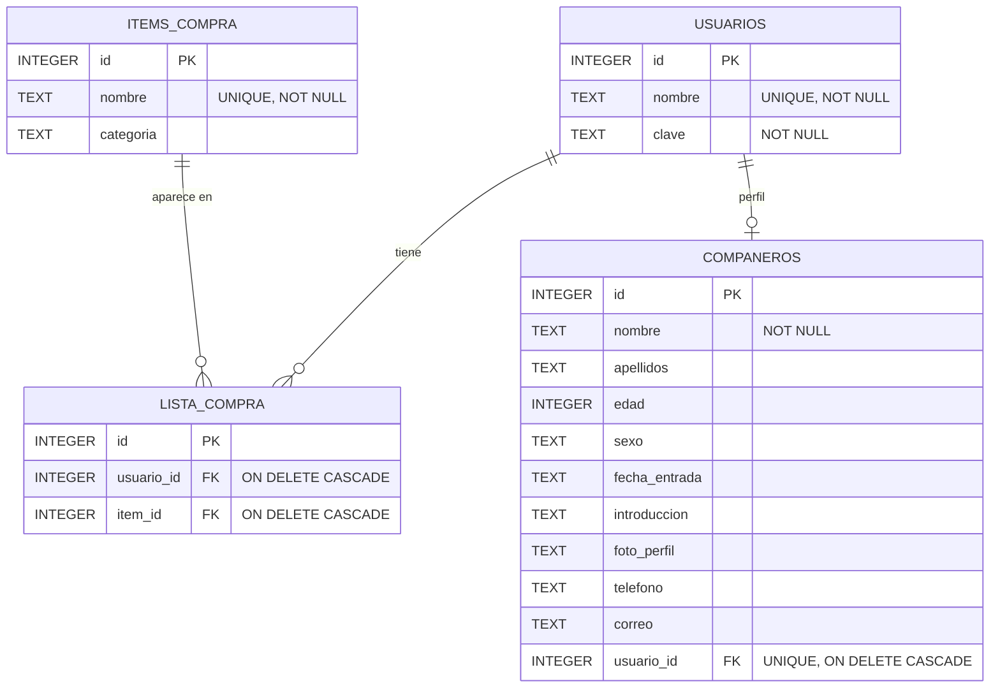
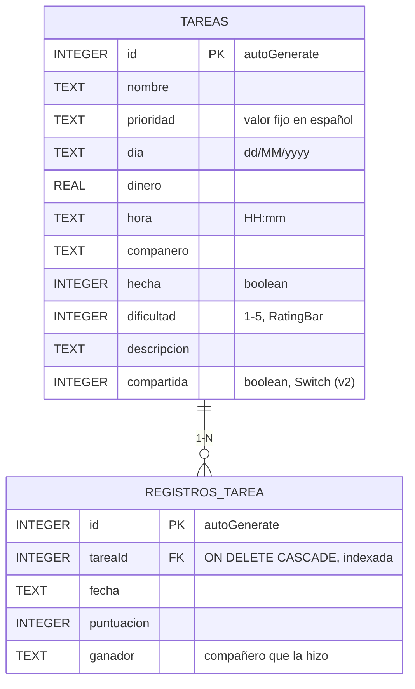

# Esquema de la base de datos

La app usa **dos bases de datos a la vez**:

- **SQLite** (`roommate.db`), gestionada con `SQLiteOpenHelper` en `RoomMateDB.java`: usuarios, lista personal, catálogo de productos y compañeros.
- **Room** (`roommate_room.db`), definida en `AppDatabase.java`: la entidad principal `Tarea` y su entidad relacionada `RegistroTarea`.

## SQLite

- `lista_compra` tiene `UNIQUE(usuario_id, item_id)`, así que un producto no puede repetirse en la lista de un usuario.
- `companeros.usuario_id` liga cada perfil con su cuenta (índice único: un perfil por usuario). Solo ese usuario puede editarlo o borrarlo. Base de datos SQLite en la **versión 3** (`onUpgrade` añade la columna y crea las cuentas de los compañeros de ejemplo).
- Al dar de baja un usuario, su lista de la compra y su perfil de compañero se borran solos gracias al `ON DELETE CASCADE`. Las claves ajenas se activan en `onConfigure()`.

## Room

- **Versión 2** de la base Room: se añadió la columna `compartida` con una migración (`MIGRACION_1_2`), para no perder los datos ya guardados.
- Al borrar una tarea, sus registros se borran automáticamente (`ForeignKey.CASCADE`).

## CRUD y consultas

| Tabla | Create | Read | Update | Delete | Consultas propias |
|---|---|---|---|---|---|
| usuarios | Registro | Login | Cambiar clave | Darse de baja | `validarUsuario` |
| lista_compra | Añadir a mi lista | Lista del usuario (JOIN) | — | Clic largo | `obtenerListaCompra`, `contarListaCompra` |
| items_compra | Nuevo producto | Spinner del catálogo | — | Borrar producto (CASCADE en las listas) | `obtenerItemsCompra` |
| companeros | Crear mi perfil | Listado / ficha / Spinner | Editar mi perfil | Borrar mi perfil (o baja del usuario, CASCADE) | `obtenerNombresCompaneros`, `obtenerCompaneroDeUsuario` |
| tareas | Añadir | Listado / ficha | Editar / CheckBox | Menú contextual | `buscarPorNombre`, `contarTareas`, `obtenerPorId` |
| registros_tarea | Nuevo registro | Por tarea | Clic en registro | Clic largo | `obtenerPorTarea`, `contarPorTarea`, `contarTotal` |

Todas las consultas se lanzan en un hilo secundario con `AppDatabase.ejecutar(...)`, y el resultado se pinta con `runOnUiThread(...)`.
