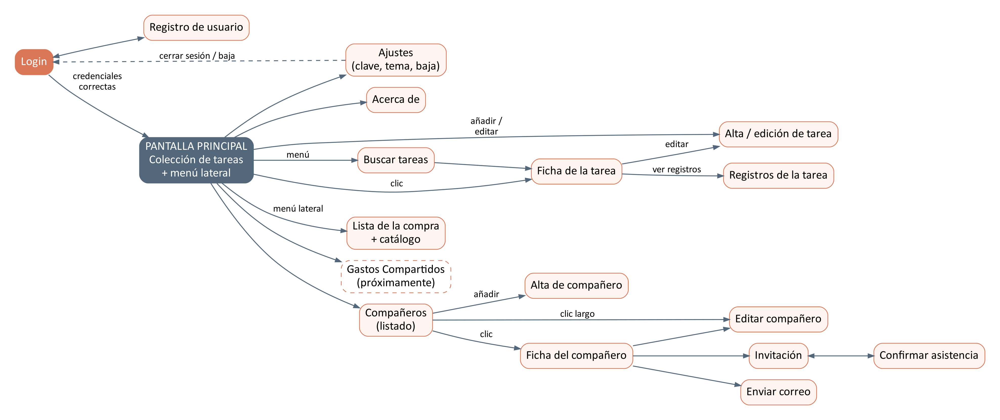
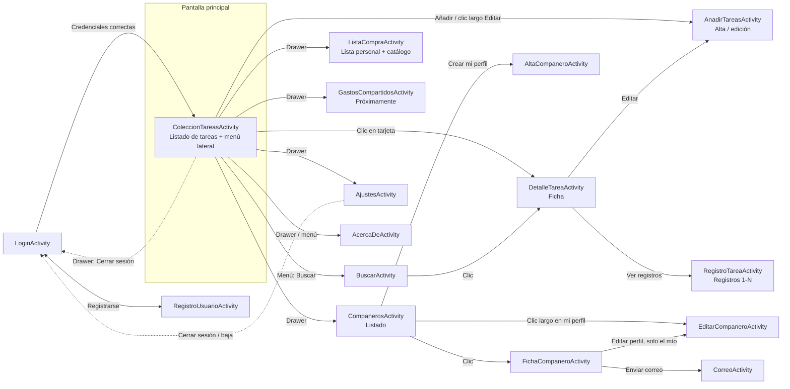

# Esquema de navegación

## Organización

- **Una sola pantalla principal**: la colección de tareas, con el menú lateral. Tras el login se llega aquí, y el botón Atrás cierra el menú si está abierto o sale de la app.
- **Menú lateral por secciones**: Tareas · Lista de la compra · Gastos Compartidos · Compañeros · Ajustes · Cambiar tema · Acerca de · Cerrar sesión. Todas las secciones vuelven a la pantalla principal.
- **Mismo patrón en tareas y compañeros**: listado (RecyclerView + CardView) → ficha → alta/edición → vuelta al listado, que se recarga en `onResume()`.
- **La relación 1-N se recorre**: desde la ficha de una tarea se abren sus registros, con la tarea ya seleccionada.
- **Perfiles propios**: cada usuario tiene un único perfil de compañero ligado a su cuenta y solo puede crear, editar o borrar el suyo; los demás perfiles son de solo lectura.
- **Correo**: se abre desde la ficha del compañero, con su dirección ya escrita.

## Vuelta de cada pantalla

Todas las pantallas tienen vuelta: botón Atrás, flecha de la barra superior o botones Volver/Cancelar/Guardar. La jerarquía está declarada en el manifest con `parentActivityName`. Al cerrar sesión o darse de baja se vuelve al login con `FLAG_ACTIVITY_CLEAR_TASK`.

## Paso del usuario entre pantallas

El `id` y el nombre del usuario que ha iniciado sesión viajan en los extras `EXTRA_USUARIO_ID` y `EXTRA_USUARIO_NOMBRE`. Si una pantalla que los necesita se abre sin ellos, vuelve al login.
